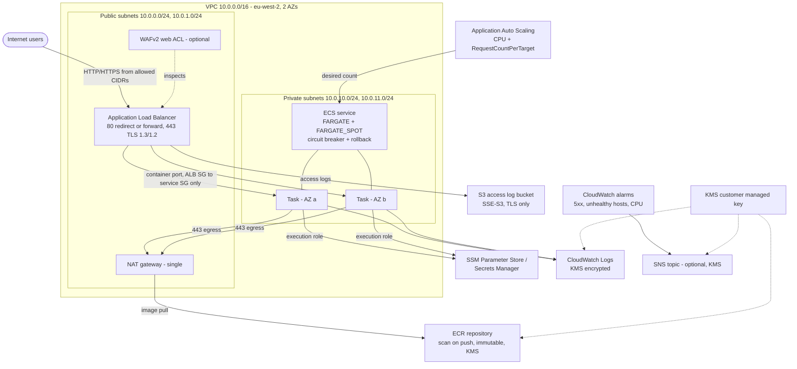

# terraform-aws-ecs-fargate-platform


## In plain English

This builds everything needed to run a website or API in a container on AWS without managing any servers. Visitors reach a load balancer on the public internet; it passes their requests to copies of the app running in a private network that nobody can reach directly. The number of copies grows and shrinks with traffic, a broken release rolls itself back, and alarms fire if errors start appearing. It can all be tested for free on a laptop, with no AWS account.

## Architecture



More detail, including the request sequence and ADR-style decisions, is in [docs/ARCHITECTURE.md](docs/ARCHITECTURE.md).

## What it demonstrates

- Composing three focused modules (`network`, `alb`, `ecs-service`) with explicit inputs and outputs
- Container security: non-root user, read-only root filesystem, secrets by ARN, private subnets, SG-to-SG rules
- Least-privilege IAM with separate execution and task roles, confused-deputy conditions on trust policies
- Encryption at rest with a customer managed KMS key and a key policy scoped by encryption context
- Zero-downtime deploys with deployment circuit breaker and automatic rollback
- Dual-metric target-tracking auto scaling and Fargate Spot cost optimisation
- Input validation that catches invalid Fargate CPU/memory pairs and unsupported Spot-on-ARM64 at plan time
- Offline `terraform test` with `mock_provider`, plus tflint and checkov in CI
- A container build and a deploy pipeline design where Terraform remains the source of truth

## Features

| Area | Feature | Toggle / variable |
|---|---|---|
| Network | 2-AZ VPC, public + private subnets via `cidrsubnet`, single NAT, locked default SG | `vpc_cidr`, `az_count` |
| ALB | Internet-facing, drop invalid headers, deletion protection | `enable_deletion_protection` |
| ALB | HTTP to HTTPS redirect with TLS 1.3/1.2 policy, or HTTP forward in demo mode | `certificate_arn` |
| ALB | Access logs to private S3 with ELB log-delivery bucket policy | `log_retention_days` |
| ALB | WAFv2 with AWS managed Common and KnownBadInputs rule sets | `enable_waf` |
| Registry | ECR: scan on push, immutable tags, KMS, keep-last-N lifecycle | `ecr_keep_last_images` |
| Cluster | Container Insights, FARGATE + FARGATE_SPOT capacity providers | `container_insights`, `fargate_weight`, `fargate_spot_weight`, `fargate_base` |
| Task | Validated CPU/memory, X86_64 or ARM64, read-only root fs, non-root user, writable scratch paths | `cpu`, `memory`, `cpu_architecture`, `readonly_root_filesystem`, `container_user`, `writable_paths` |
| Task | Secrets from SSM Parameter Store / Secrets Manager ARNs | `secrets`, `secrets_kms_key_arns` |
| IAM | Separate execution and task roles, optional extra task policies | `task_role_policy_arns` |
| Service | Private subnets, circuit breaker + rollback, health check grace period | `health_check_grace_period_seconds` |
| Service | ECS Exec with KMS-encrypted, logged sessions | `enable_execute_command` |
| Scaling | Target tracking on CPU and ALB RequestCountPerTarget | `enable_autoscaling`, `autoscaling_*` |
| Alarms | Target 5xx, unhealthy hosts, CPU high, optional encrypted SNS topic | `enable_alarms`, `create_alarm_topic`, `alarm_actions` |

## Quick start

### Free path - no AWS account needed

```bash
cd examples/complete
terraform init -backend=false -input=false
terraform validate
terraform test
```

`terraform test` runs 10 plan-only scenarios against a mocked AWS provider. `terraform plan` against real AWS needs credentials.

### Real deploy

> **Cost warning:** this creates a NAT gateway, an ALB and two always-on Fargate tasks. Expect roughly 80-100 USD/month if left running. Run `terraform destroy` when finished.

```bash
cd examples/complete
cp terraform.tfvars.example terraform.tfvars
terraform init
terraform apply
terraform output service_url
```

The default image is `public.ecr.aws/docker/library/nginx:stable-alpine` on port 80. Stock nginx needs root and a writable filesystem, so the example sets `container_user = null` and `readonly_root_filesystem = false` with a comment. The module defaults are the hardened ones (`1000:1000`, read-only).

### Build and push your own image

The [app/](app/) folder contains a small `nginx-unprivileged` image (UID 101, port 8080) that runs with the hardened defaults.

```bash
cd examples/complete
REPO=$(terraform output -raw ecr_repository_url)
TAG=$(git rev-parse --short HEAD)

aws ecr get-login-password --region eu-west-2 | docker login --username AWS --password-stdin "${REPO%%/*}"
docker build --platform linux/amd64 -t "$REPO:$TAG" ../../app
docker push "$REPO:$TAG"

terraform apply \
  -var "container_image=$REPO:$TAG" -var "container_port=8080" -var "container_user=101" \
  -var "readonly_root_filesystem=true" -var 'writable_paths=["/tmp"]'
```

An example GitHub Actions pipeline (OIDC, build, Trivy scan, push, `terraform apply`) is in [docs/examples/deploy.yml](docs/examples/deploy.yml). It is kept out of `.github/workflows` on purpose so it never runs in this repo.

## Cost estimate

Approximate, on-demand, eu-west-2, not verified against current AWS pricing - check the [AWS Pricing Calculator](https://calculator.aws/).

| Item | Basis | Approx. USD/month |
|---|---|---|
| NAT gateway | 1 x 730 h, plus 0.05/GB processed | 35-40 |
| Application Load Balancer | 730 h + low LCU usage | 20-25 |
| Fargate tasks | 2 x 0.25 vCPU / 0.5 GB on-demand (Spot weight 1 lowers this) | 15-21 |
| Public IPv4 addresses | ALB (2) + NAT EIP | ~11 |
| Container Insights, CloudWatch Logs, alarms | Light traffic | 3-6 |
| KMS customer managed key | 1 key + requests | ~1 |
| WAFv2 (if `enable_waf = true`) | Web ACL + 2 rule groups + requests | 7-8 |
| S3 access logs, ECR storage | A few GB | < 1 |

Always run `terraform destroy` when you are done; the NAT gateway and ALB bill by the hour whether or not anyone visits.

## Design decisions

| Decision | Why | Trade-off |
|---|---|---|
| Internal `modules/network` | Repo runs standalone for reviewers | Minimal: no flow logs or endpoints. Full VPC is [terraform-aws-vpc-foundation](https://github.com/mhkhan01/terraform-aws-vpc-foundation) |
| Single NAT gateway | Cuts NAT cost by half versus one per AZ | Losing that AZ stops image pulls for all tasks |
| Port 80 forwards when no certificate | Demo works without a domain | No TLS in demo mode; set `certificate_arn` for production |
| ALB module owns both SGs | The "ALB only" rule is defined once, ports cannot drift | ALB and service are coupled through one module |
| Separate execution and task roles | Application code cannot read launch secrets or pull images | Two roles to reason about |
| Fargate base 1 on on-demand + Spot weight | Spot savings without risking zero capacity | Spot tasks can be interrupted with 2 minutes notice |
| CPU and request-count scaling | Covers both CPU-bound and IO-bound load | Two policies to tune |
| Terraform owns the task definition in CI | No state drift, every deploy is a reviewed plan | Deploys need Terraform state access |
| ALB logs on SSE-S3 | ELB log delivery does not support SSE-KMS | Bucket uses an AWS managed key |

## Testing & CI

| Check | What it proves |
|---|---|
| `terraform fmt -check -recursive` | Consistent formatting |
| `terraform validate` | Configuration matches the AWS provider v6 schema |
| `terraform test` (10 runs, `mock_provider`) | CIDR math, listener redirect vs forward, HTTPS SG rules per CIDR, WAF/Exec toggles, Spot weights, container hardening (user, read-only fs, writable mounts, secrets by ARN), naming, and validation failures for bad CIDR, environment, Fargate size, Spot on ARM64, root user, plain-text secrets |
| `tflint` (terraform recommended + AWS ruleset) | Unused declarations, typed variables, invalid AWS values |
| `checkov` | Security misconfiguration scan, 0 failed with justified skips |

All three CI jobs run on every push to `main` and every pull request, with read-only permissions. Run the same locally with `make all`.

## Security

Controls applied:

- Tasks in private subnets with no public IP; only the ALB SG can reach the container port; task egress limited to 443
- Non-root user and read-only root filesystem by default; privileged mode off; root user rejected by validation
- Secrets injected by ARN only (validated); execution role can read only the listed ARNs
- Customer managed KMS key with rotation for ECR, logs, ECS Exec and SNS; key policy scoped by encryption context
- ECR scan on push and immutable tags
- ALB drops invalid headers; TLS 1.3/1.2 policy; optional WAF with managed rules
- Access log bucket: public access blocked, bucket-owner-enforced, versioned, TLS-only policy, lifecycle expiry
- Default security group stripped of all rules
- Trust policies restricted with `aws:SourceAccount` and `aws:SourceArn`

Checkov skips (each justified in [.checkov.yaml](.checkov.yaml)):

| Check | Reason |
|---|---|
| CKV_AWS_260 | Public ALB must accept port 80; service-SG hit is a false positive (source is the ALB SG) |
| CKV_AWS_150 | Module defaults deletion protection on; only the demo example disables it |
| CKV_AWS_109, CKV_AWS_111, CKV_AWS_356 | KMS key policy `Resource "*"` refers to the key itself |
| CKV_AWS_338 | Log retention is a variable; 30-day default for cost |
| CKV_AWS_394 | AZ list is sliced to `az_count` |
| CKV_AWS_18, CKV_AWS_144, CKV_AWS_145, CKV2_AWS_62 | ALB log bucket: is the log sink, replication not worth it, ELB requires SSE-S3, no event consumers |
| CKV2_AWS_11 | Flow logs live in terraform-aws-vpc-foundation |
| CKV2_AWS_31, CKV2_AWS_76 | WAF is optional; Log4j rules included when on; WAF logging on the roadmap |
| CKV2_AWS_5 | Service SG attached in another module |
| CKV_AWS_378 | TLS terminates at the ALB; traffic to tasks stays private |
| CKV_AWS_103, CKV2_AWS_20 | HTTP forward only in documented demo mode without a certificate |

## Module reference

- [modules/network](modules/network/README.md)
- [modules/alb](modules/alb/README.md)
- [modules/ecs-service](modules/ecs-service/README.md)

Operational procedures: [docs/RUNBOOK.md](docs/RUNBOOK.md).

## Roadmap / Production hardening

- VPC interface endpoints (ECR, Logs, Secrets Manager, SSM) and an S3 gateway endpoint to remove the NAT path for AWS traffic
- Swap `modules/network` for terraform-aws-vpc-foundation with per-AZ NAT and flow logs
- WAF logging to an `aws-waf-logs-*` destination, plus rate-based rules
- Blue/green deployments with CodeDeploy or ECS native blue/green and test listeners
- Drop Linux capabilities and add a container-level health check
- Route 53 alias record and ACM certificate with DNS validation
- Cross-account log archive for ALB and application logs

## Related repos

- [terraform-aws-state-bootstrap](https://github.com/mhkhan01/terraform-aws-state-bootstrap)
- [terraform-aws-vpc-foundation](https://github.com/mhkhan01/terraform-aws-vpc-foundation)
- [terraform-aws-ecs-fargate-platform](https://github.com/mhkhan01/terraform-aws-ecs-fargate-platform) (this repo)
- [terraform-aws-eks-platform](https://github.com/mhkhan01/terraform-aws-eks-platform)
- [terraform-aws-serverless-api](https://github.com/mhkhan01/terraform-aws-serverless-api)
- [terraform-aws-static-site](https://github.com/mhkhan01/terraform-aws-static-site)
- [terraform-aws-security-baseline](https://github.com/mhkhan01/terraform-aws-security-baseline)

## Author

Mohammed Haris Khan - Cloud Engineer, Birmingham UK - [GitHub](https://github.com/mhkhan01) - [LinkedIn](https://www.linkedin.com/in/mohammed-haris-khan)
