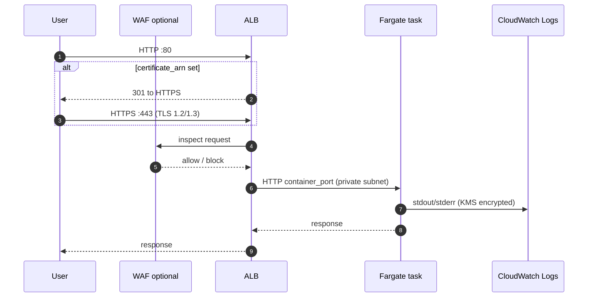
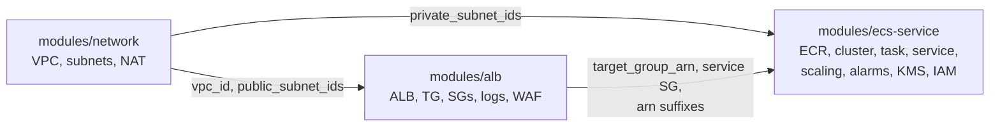

# Architecture

## Request path

## Module boundaries

The ALB module owns **both** security groups. That keeps the "only the ALB can reach the
container port" rule in one place: the two SGs reference each other, and neither module
can drift from the other's port.

## Decisions (ADR style)

### ADR-001: Self-contained network module
- **Context:** The example must be runnable on its own for reviewers.
- **Decision:** Ship a small internal `modules/network` (2 AZs, single NAT, `cidrsubnet` math).
- **Consequence:** No flow logs, endpoints or per-AZ NAT here. The full-featured VPC is
  [terraform-aws-vpc-foundation](https://github.com/mhkhan01/terraform-aws-vpc-foundation);
  in production, swap the module call and pass its outputs instead.

### ADR-002: Separate execution role and task role
- **Context:** ECS can run with one role, but that role then needs image-pull and
  secret-read rights that the application never uses.
- **Decision:** Execution role = image pull, log write, secret injection, scoped to the
  exact repository, log group and secret ARNs. Task role = empty by default, plus ECS Exec
  channels only when Exec is enabled.
- **Consequence:** A compromised container cannot call `secretsmanager:GetSecretValue` on
  the secrets it was launched with.

### ADR-003: Port 80 behaviour depends on `certificate_arn`
- **Context:** A demo should work without owning a domain; production must be HTTPS-only.
- **Decision:** With a certificate, port 80 returns a 301 to HTTPS and a TLS 1.3/1.2
  listener forwards. Without one, port 80 forwards directly (documented demo mode).
- **Consequence:** Two checkov rules (CKV_AWS_103, CKV2_AWS_20) are skipped with justification.

### ADR-004: Fargate on-demand base plus Spot weight
- **Decision:** `fargate_base = 1` keeps at least one task on on-demand capacity; extra
  tasks are split by `fargate_weight` / `fargate_spot_weight`.
- **Consequence:** Spot interruptions reduce capacity but never take the service to zero.
  ARM64 tasks are blocked from Spot by a variable validation because AWS does not offer it.

### ADR-005: Two target-tracking policies
- **Decision:** Track CPU and `ALBRequestCountPerTarget` together. Application Auto Scaling
  takes the larger desired count.
- **Consequence:** IO-bound services that never stress CPU still scale with traffic.

### ADR-006: Terraform owns the task definition
- **Decision:** CI pushes an immutable image tag and runs `terraform apply` with it,
  rather than calling `ecs update-service` directly.
- **Consequence:** No drift between state and what is running; a deploy is a reviewed plan.
  `desired_count` is in `ignore_changes` so auto scaling decisions are not reverted.

### ADR-007: One CMK per service
- **Decision:** A single customer managed key encrypts ECR, application and Exec logs,
  Exec sessions and the alarm SNS topic. The key policy grants CloudWatch Logs access only
  for this service's log groups (encryption-context condition) and CloudWatch alarms only
  from this account.
- **Consequence:** Destroying the service schedules one key for deletion; a 7-day window
  is the minimum AWS allows.

### ADR-008: ALB logs use SSE-S3, not KMS
- **Decision:** The access-log bucket uses AES256. ELB log delivery does not support
  SSE-KMS, and the regional ELB account (eu-west-2 predates the log-delivery service
  principal) is granted `s3:PutObject` on the exact prefix only.

## Security controls summary

| Layer | Control |
|---|---|
| Edge | Optional WAFv2 (Common + KnownBadInputs), drop invalid headers, TLS policy `ELBSecurityPolicy-TLS13-1-2-2021-06` |
| Network | Tasks in private subnets, no public IPs, SG-to-SG rule on container port only, egress 443 only |
| Compute | Non-root user by default, read-only root filesystem by default, no privileged mode |
| Identity | Split roles, resource-scoped policies, `aws:SourceAccount` / `aws:SourceArn` on trust policies |
| Data | KMS on ECR, logs, Exec, SNS; secrets by ARN only (validated) |
| Supply chain | ECR scan on push, immutable tags, lifecycle expiry |
| Operations | Circuit breaker with rollback, alarms, Container Insights, Exec audit logs |
